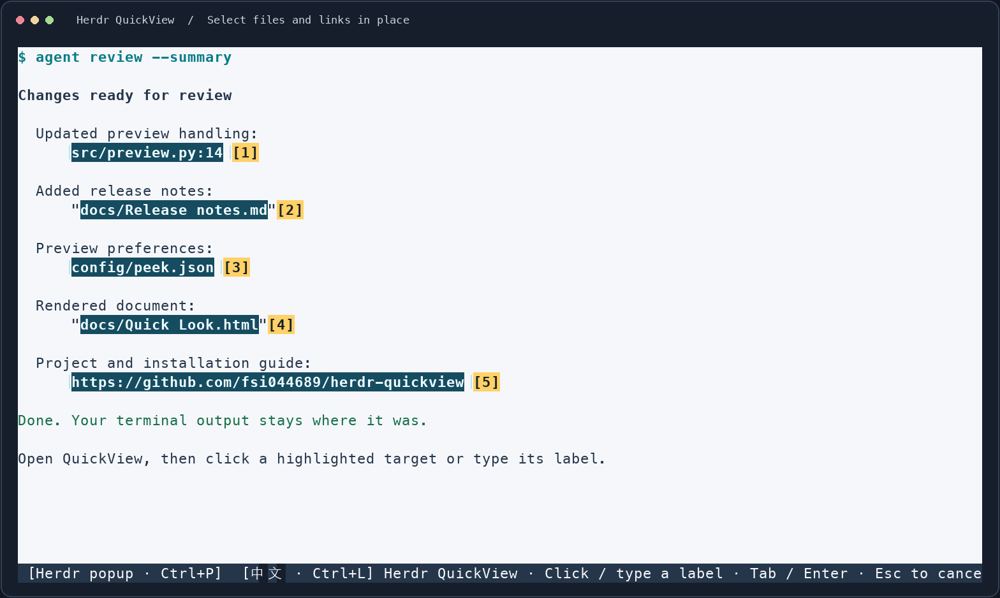
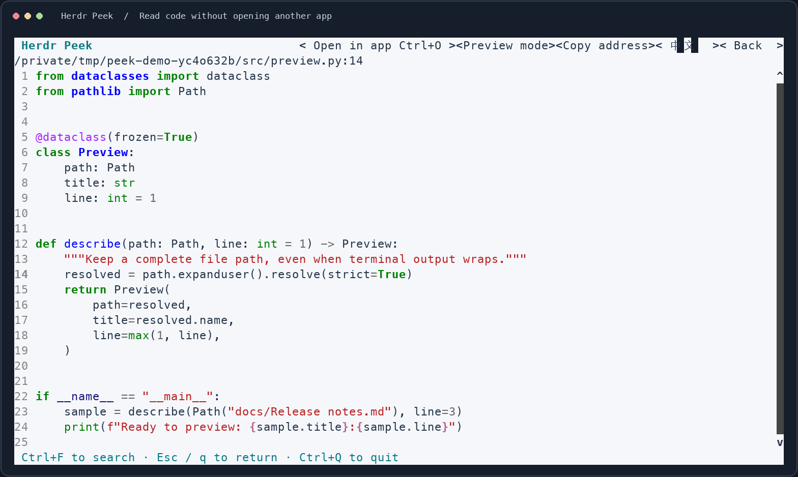
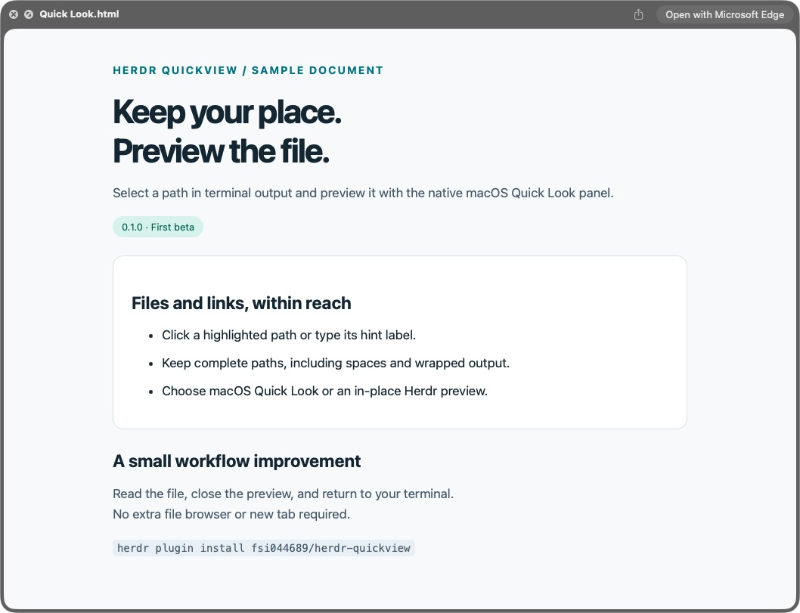

# Herdr Peek

独立的 Herdr 文件与链接速览插件。当前版本 **0.1.0**，首个测试版本。

## 看看效果

**路径在哪，就在哪选。** 打开 Peek 后，直接点击高亮的文件或链接，也可以输入旁边的编号立即预览。



**两种预览方式，自己选。** 按 **Ctrl+P** 切换 Herdr 内预览或 macOS 系统速览，选择会自动保存。

| 直接在 Herdr 里看 | 使用 macOS 系统 Quick Look |
| --- | --- |
|  |  |
| 阅读代码、**Ctrl+F** 搜索，或按 **Ctrl+O** 用默认应用打开。 | 使用系统面板预览支持的文档，**Esc** 返回路径选择，继续查看下一个文件。 |

终端示例图由 Peek 的真实界面渲染器配合示例 CLI 输出导出；Quick Look 图为真实 macOS 窗口截图。终端配色及系统预览效果随本机配置而异。

## 怎么用

1. 从目标 CLI 窗格调用 Herdr Peek action，或先按下方示例配置快捷键。插件不会自动安装快捷键；示例为 **prefix+u**，实际前缀由你的 Herdr 配置决定。
2. 可定位的路径或链接显示整段蓝绿色底色和黄色 **[1] [2] … [a] [b]** 编号框；空白足够时加外边框。**直接点击原文或编号框**，也可直接输入编号打开，**不必回车**。Tab / Shift+Tab 切换、Enter 打开仍可用。
3. 底栏显示当前预览方式。**Ctrl+P** 或点击底栏的模式区域切换 **macOS 系统 / Herdr 浮窗**，自动保存；正文页也有「切换预览」按钮，影响下次选择。macOS 默认系统速览，其他系统仅 Herdr 浮窗。
4. 系统模式打开真正的 **QLPreviewPanel**，确认面板可见且获得焦点后保留后台选择层；关闭系统面板后回到选择层，启动失败回退 Herdr。Herdr 模式在当前浮窗显示文件文本或网页可读正文。正文页点击「默认应用打开」或按 **Ctrl+O**，才把当前文件交给系统关联应用，或把 URL 交给默认浏览器；不支持预览的格式也有此入口。
5. Herdr 预览页按 **Esc / q** 或点「返回」，回到原来的路径选择层，可继续查看其他文件；系统 Quick Look 按 Esc / 空格 / Cmd+W 关闭后也回到选择层。在选择层按 **Esc / q** 才退出插件；插件界面按 **Ctrl+Q** 可直接退出。搜索时第一个 Esc 只退出搜索。

编号先用 1–9、0，再用字母（q 留给关闭）。目标多时统一使用等长多字符编号，例如输入 `12` 直达；输入过程中可用 Backspace 删除。编号框尽量放在路径旁的空白处，实在没有空白时覆盖路径开头几个字符，不移动原文或覆盖相邻文字。

没有文件列表、筛选页、模块管理页或新 tab。Herdr 正文预览支持行号、高亮、Ctrl+F 搜索、「默认应用打开」（Ctrl+O）和「复制地址」，复制的是完整真实路径或原始 URL，不带终端显示折行。插件启停由 Herdr 插件管理负责。

## 界面语言

- 默认英文，不检测操作系统语言，不依赖终端的 LANG/LC_*；macOS 和 Linux 行为一致。
- 按 **Ctrl+L**，或点击选择层底栏/正文页顶部的 **中文 / English** 切换；按钮和后续提示立即使用所选语言，选择会自动保存，下次打开继续沿用。加载中忽略切换，保存失败保留原语言。
- 与预览模式保存在同一个 `config.toml`，语言字段为 `language = "en"` 或 `language = "zh"`；写入保留其他设置、注释和配置软链接。
- 翻译覆盖插件自身的按钮、搜索、状态和错误提示。文件内容、网页原文、路径及外部程序返回的错误保留原文；系统 Quick Look 的工具栏语言由 macOS 管理。Herdr 静态入口和浮窗标题统一使用品牌名 Herdr Peek。

## 原位选择的实现与限制

- Herdr 0.9.5 不能给任意终端原文注册普通点击事件。快捷键打开一个 **100% 临时 popup 选择层**，复制当前 tab 各可见窗格的文字和 ANSI 颜色，并按原坐标放置；只在来源窗格标记路径。选择期间画面是静态快照，底层 CLI 继续运行。
- 不调整来源窗格大小、不滚动、不读取历史、不查询 Git、不扫描整个项目。选择层按 Esc 返回实时画面；从预览返回时保留同一份快照和编号，不重新扫描新输出。
- Herdr 强制 popup 边框及一列 gutter；处在这些边缘上的原文会被裁剪，不平移或重新折行来凑位置。完全不可见的路径不会成为键盘选择目标。终端内图像和各窗格边框不重绘，当前并非整个 tab 的像素级复制。
- 改变窗口大小后立即禁用旧点击区域；请 Esc 退出并重新打开，避免按陈旧坐标误选。
- 路径识别使用原生选区读取还原软折行，并映射回原屏幕位置。CLI 自己插入的换行，仅在路径有括号/引号包裹、续行带缩进且还原后文件真实存在时去掉换行和续行缩进；不跨空白段落或拼接无缩进的真实换行。裸 `file:///` / `file://localhost/` 编码 URI 也支持紧邻的缩进续行，包含 `%编码` 中间断行；逐段还原到第一个真实存在的文件，单行已有文件优先，不跨空白段或吞掉另一条已存在的绝对路径或另一 URL。如果 URI 的 `#L行号` 本身被 CLI 硬折开，可能只识别文件而丢失行号；画面变化或无法可靠还原时，仅标记能确认的路径。
- 相对路径以来源 CLI 工作目录为准，只接受已存在的普通文件，不猜测其他仓库中的同名文件。支持中文、空格、括号、Markdown 链接及 `<路径>` 目标、file://、:行号[:列号] / #L行号[-L结束行]。实际存在的完整文件名优先于行号解释，例如文件本身名为 `source.py:12` 时打开该文件。
- 支持以 `/`、`./`、`../`、`~/` 开头路径中的 shell 反斜杠转义空格；先验证原样文件名，再验证 shell 转义结果，不执行命令或展开变量。带空格的普通相对路径建议加引号/反引号。Makefile、README、.env 等无扩展名文件也可识别。
- 同一画面里重复出现的路径分别保留点击位置；文件存在性结果只在本次扫描中复用，下一次打开重新检查，不保留跨扫描的失效缓存。远端 file:// URI 和目录不作为文件预览目标。HTTP(S) URL 独立识别，不检查本地文件，也不在扫描时请求网络；URL 中的路径和查询参数不再被误标为本机文件。
- 识别范围仅为打开时可见的文件路径和链接；若没找到，Esc 返回，把路径滚到可见区域再打开。

## 预览方式与 URL

设置保存在 Herdr 注入的 `HERDR_PLUGIN_CONFIG_DIR/config.toml`，通常为 `~/.config/herdr/plugins/config/sylar.herdr-peek/config.toml`：

```toml
preview_mode = "macos" # 或 "herdr"
```

- 切换先保存成功再更新界面；编号字母不变。加载中忽略切换，Esc 可取消。配置错误会提示且拒绝覆盖；原子写入保留其他字段、注释及配置软链接。
- 系统预览只在本机 macOS 且原生组件可用时开启。SSH、其他系统或组件缺失会说明原因并使用 Herdr，保留已保存偏好。单次启动失败回退也不修改偏好。
- URL 支持大小写 HTTP(S)、中文/国际化域名、localhost、IPv6、端口、query、fragment、百分号编码、Markdown/尖括号/引号、配对括号和软折行。保留原 URL 用于复制，网络请求才进行 IDNA/百分号编码并去掉 fragment。
- URL 没有文件存在性可核对：只在显式包裹完整闭合且续行带缩进时还原 CLI 硬折行。裸链接或包裹未闭合时不拼下一行。即使闭合，URL 与紧贴的中文正文仍可能有歧义，建议用空格、尖括号或 Markdown 明确边界。
- 仅处理带 scheme 的 HTTP(S) URL，不猜测 `www.`，不接收 URL 中的账号密码。
- macOS 的在线 URL 已在本机 **macOS 26.2** 用生产组件验证显示于系统 Quick Look；Apple 的 [QLPreviewItem 文档](https://developer.apple.com/documentation/quicklookui/qlpreviewitem/previewitemurl) 仍约定文件 URL，因此不保证其他 macOS 版本。面板启动失败可回退；面板出现后的网页加载错误没有公开回调，不能自动识别并回退。
- Herdr 网页预览提取标题、可读正文及链接，也支持 text/plain 和 JSON；读取上限 2 MiB，总等待最多 8 秒，拒绝重定向到非 HTTP(S)，清理终端控制码。它不执行 JavaScript、不共享浏览器登录态、不渲染网页图片/PDF；这类页面可能不完整或明确报不支持，不自动跳浏览器。

## 默认应用打开

- 正文页和不支持格式的提示页都有「默认应用打开」按钮，快捷键 **Ctrl+O**；文件使用完整真实绝对路径，不包含行号，URL 使用完整原始地址。
- macOS 文件调用系统 `open`，URL 使用 `open -u` 明确交给 URL scheme 的默认应用；Linux 使用 `xdg-open`。相当于交给系统关联程序处理，不承诺所有格式都有可用的关联应用。
- 只有主动点击或按 Ctrl+O 才唤起应用。请求成功后保留预览页；返回码只表示系统接受请求，不表示应用已经显示内容。失败、缺少打开器或等待超时会提示未确认，不自动重试。
- 后台执行且隔离标准输入和标准输出，错误输出用临时文件收集，避免子程序继承管道导致误等应用退出；限制等待 8 秒；进行中忽略重复操作，Esc 可返回选择层，Ctrl+Q 直接退出 Peek；返回后旧操作的反馈不会覆盖下一份预览。检测到 SSH 时不尝试唤起远端服务器 GUI，提示复制地址到本机。

## 平台

- 本机 macOS：自己的小型原生宿主提供文件或 HTTP(S) URL，预览内容、标题和工具栏由 Apple 的 [QLPreviewPanel](https://developer.apple.com/documentation/quicklookui/qlpreviewpanel) 绘制；不使用 `qlmanage -p` 诊断窗口，不打开 Finder。系统标准面板不保证和 Finder 自带的附加操作逐项一致。
- 原生宿主确认自己是前台应用、面板可见且为键盘焦点窗口后，才向选择层回报成功；失败约 3 秒后回退。无辅助功能或 System Events 权限要求。
- 存在 SSH_CONNECTION 或 SSH_TTY 时使用 Herdr 预览。未设置这些变量的远程附着，当前协议无法完整识别，仍需实机验证。
- Herdr 内预览上限 2 MiB，只支持 UTF-8 文本和代码，暂不渲染图片、PDF、压缩包等二进制内容。macOS 格式支持由系统 Quick Look 决定。
- 临时画面交接文件权限为 0600，读取后立即删除；不长期保存终端文本。

## 安装与开发

需要 Herdr >= 0.9.5、Python >= 3.11，支持 macOS/Linux。

从 GitHub 安装：

```sh
herdr plugin install fsi044689/herdr-peek
```

安装后按下方示例配置入口快捷键，插件不会自动添加快捷键。

从源码构建并链接：

```sh
sh bootstrap.sh # 自动寻找 Python 3.11+；也可 PYTHON=python3.11 sh bootstrap.sh
herdr plugin link /absolute/path/to/herdr-peek
```

依赖只安装到插件自己的 `.venv`，安装需要联网获取 Python 依赖。Python 版本不满足时会在建环境前明确失败；再次构建会重建版本过旧或损坏的插件运行环境。如果按快捷键没有界面，请在源码目录重新执行 `sh bootstrap.sh`。macOS 安装时使用 Xcode Command Line Tools 编译并本地签名原生宿主，产物在 `.native/Herdr Peek.app`；缺少编译工具时仅使用 Herdr 内预览。Linux 跳过此构建。插件 ID 为 `sylar.herdr-peek`，action 为 `peek`。

```toml
[[keys.command]]
key = "prefix+u"
type = "plugin_action"
command = "sylar.herdr-peek.peek"
description = "Herdr Peek · 文件速览"
```

修改快捷键后运行 `herdr config check`、`herdr server reload-config`，无需重启 Herdr。

```sh
.venv/bin/python -m unittest discover -s tests -v
```

127 项测试包括路径矩阵、URL 与本地 HTTP 服务、设置读写，以及真实 prompt_toolkit 输入管道/鼠标序列测试：

- 路径：18 种文件名与引号/Markdown 组合、行号、shell 转义、每个字符位置的软折行、CLI 缩进折行、ANSI/OSC8、重复出现、不存在文件、撇号及未知 HOME 文本。
- URL：query/fragment/编码、中文、IPv6、Markdown、配对括号、与本机文件混排/不重叠、软折行、未闭合包裹不拼正文；扫描零网络请求。
- HTTP：本机临时服务的 HTML/文本/JSON、charset、重定向、404、二进制拒绝、2 MiB 截断及多字节边界、控制码清理；超时/取消、复制原 URL、原生失败回退。
- 默认应用：macOS 文件/URL 参数、Linux 打开器、隔离 stdin、超时与失败、缺失文件/工具、SSH 限制；正文及不支持格式页的按钮/快捷键、复制与内容保留、取消及防重复。
- 连续预览：Esc / q / 返回按钮回到原编号层、连续查看不同文件、系统面板关闭后继续选择、搜索与直接退出、加载/复制/默认应用请求返回后不覆盖下一份预览。
- 发布回归：坏配置仍可启动并显示错误、80 列反馈和地址可见、Python 版本预检与版本化解释器选择、缺失运行环境提示。
- 设置：Ctrl+P 和底栏鼠标切换、持久化、非 macOS/SSH 限制、配置错误、软链接/注释、写失败不改变模式、忙碌时不切换。
- 语言：各平台默认英文且不检测系统语言、Ctrl+L/底栏/正文按钮切换、重开沿用、搜索提示、80 列双语按钮完整显示、配置与模式共存、写失败保护、翻译模板完整性及文件正文不被翻译。

### 文件类型验收（2026-10-23）

以下使用本地合成样本，不读取用户业务文档。Herdr 分支通过实际 prompt_toolkit 应用断言显示内容；macOS 分支使用生产原生组件，由 AX 或截图核对真实面板内容。

| 类型 | macOS 系统速览（本机） | Herdr 浮窗 |
| --- | --- | --- |
| 中文空格 TXT、Python、JSON | 已实际显示内容 | 文本/代码已验证 |
| Markdown | 已显示渲染内容，本机有 Quick Look 扩展 | Markdown 源文本已验证 |
| 本地 HTML、SVG | 已渲染网页/图像 | 源码文本已验证，非图形渲染 |
| PNG、PDF | 已实际显示图像/页面内容 | 未支持渲染，明确提示；不将 PDF 源码当正文 |
| ZIP | 本机扩展显示压缩包目录 | 未支持，明确提示 |
| 普通 BIN | 未产生可读内容，不计预览成功 | 未支持，明确提示 |
| HTTP(S) 网页 URL | 已实际显示系统网页速览 | 本地 HTTP 样本的标题、正文、链接已验证 |

本机安装的系统 Quick Look 扩展会影响代码、Markdown、压缩包等格式的支持，不代表所有 macOS 安装都相同。真实 Herdr popup 启动及配置目录环境注入已确认；Ctrl+P、Ctrl+O、Ctrl+L 及鼠标交互通过输入管道测试，尚未验证实体 Herdr 客户端中的按键传递。默认应用功能验证了请求参数和失败链路，未自动唤起用户实际关联应用做验收。非 macOS 分支有平台模拟测试，尚无 Linux 实机验收。

已回放实际 CLI 窗格的版本号加中文空格文件名两行路径。路径扫描性能样例为本机 65 行重复混合输出，5 次中最快约 1.4 ms，仅代表开发阶段的扫描测量，不代表当前版本整体、系统预览启动或其他机器耗时。原生组件本轮已重新编译、签名并完成上述本机内容验收。

## 许可证

采用 [MIT 许可证](LICENSE)，版权所有 (c) 2026 sylar。允许使用、修改、分发及商用，须保留版权及许可声明。
